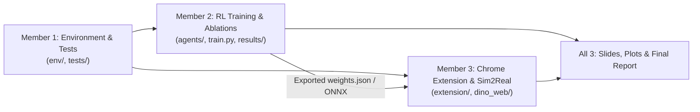

> **Superseded by [`PROJECT_PLAN.md`](PROJECT_PLAN.md).** Kept for historical reference (earlier Chrome-Extension-first draft).

# Implementation Plan: Chrome Dino RL (Group of 3)

## Goal Description
Build a reproducible Reinforcement Learning pipeline for the **Chrome Dino** endless runner aligned with `final_project.pdf`, `IDEA.md`, and `LEARNINGS.md`:
1. **Fast Python Simulation (`env/`):** A headless `gymnasium.Env` matching Chromium's `offline.js` physics, hitboxes, and obstacle spawning at thousands of FPS.
2. **RL Training & Diagnostics (`agents/`, `train.py`, `results/`):** A Heuristic baseline plus 1–2 Deep RL agents (DQN / PPO) with multi-seed logging, ablation studies, and weight export.
3. **Real-Browser Deployment (`extension/`):** A Manifest V3 Chrome Extension running exported policies at 60 FPS inside a locally hosted copy of Chromium's Dino JS engine (`http://localhost`) for live evaluation and the final presentation demo.

---

## Team Division (Group of 3)



| Member | Primary Ownership | Key Deliverables |
| :--- | :--- | :--- |
| **Member 1** | `env/`, `tests/` | `DinoEnv(gymnasium.Env)` with exact `offline.js` physics, two-tier `CollisionBox` hitboxes, normalized vector obs, unit tests |
| **Member 2** | `agents/`, `train.py`, `results/` | Heuristic baseline, DQN/PPO training & hyperparameter tuning, reward/state ablations, learning curve plots, weight exporter |
| **Member 3** | `extension/`, `results/` | Local Chromium Dino host (`dino_web/`), MV3 extension (`manifest.json`, `content_main.js`, `popup`), sim-to-real score evaluation |

> **Parallelism:** Member 1 defines the observation/action schema first (Day 1) so Member 2 can immediately test on an initial `DinoEnv` and Member 3 can build the local Dino host + MV3 extension using the same observation contract.

---

## Open Questions (Decide Before Scaffolding)

1. **Project Path (from `IDEA.md`):**
   - **Path A (Recommended, ~20–28h):** Vector-state deep dive (**Heuristic** vs. **DQN** vs. **PPO**), lightweight `.json` weight export to the extension.
   - **Path B (~32–45h):** **Vector-DQN** vs. **Pixel-CNN-DQN** (adds pixel rendering + score-700 day/night inversion study + ONNX/WebSocket export).
   - **Path C (~30–42h):** **From-scratch PyTorch** implementation of one algorithm (DQN or PPO) + deep sim-to-real parity analysis.
2. **RL Library Preference:** **Stable-Baselines3** (faster iteration on ablations/hyperparameters) or **custom PyTorch** (more control for explaining internals in Q&A).

---

## Proposed Components

### 1. Project Setup & Dependencies
- **`requirements.txt`:** `gymnasium>=0.29`, `numpy`, `torch`, `stable-baselines3`, `matplotlib`, `pytest`.

### 2. Simulation Environment (`env/`) — *Member 1*
- **`env/constants.py`:** Exact `Runner.config` and `Trex.collisionBoxes` constants from Chromium `offline.js`:
  ```python
  FPS = 60
  CANVAS_WIDTH = 600
  CANVAS_HEIGHT = 150

  SPEED = 6.0
  MAX_SPEED = 13.0
  ACCELERATION = 0.001
  GAP_COEFFICIENT = 0.6
  INVERT_DISTANCE = 700

  GRAVITY = 0.6
  INITIAL_JUMP_VELOCITY = 12.0
  SPEED_DROP_COEFFICIENT = 3.0

  # Trex hitboxes: (x, y, w, h)
  TREX_RUNNING_BOXES = [
      (22, 0, 17, 16), (1, 18, 30, 9), (10, 35, 14, 8),
      (1, 24, 29, 5), (5, 30, 21, 4), (9, 34, 15, 4),
  ]
  TREX_DUCKING_BOXES = [(1, 18, 55, 25)]
  PTERODACTYL_Y_POS = [100, 75, 50]  # low, mid, high
  ```
- **`env/dino_env.py` (`DinoEnv(gymnasium.Env)`):**
  - `action_space = spaces.Discrete(3)` (`0`: Run, `1`: Jump, `2`: Duck / fast-fall).
  - `observation_space = spaces.Box(low=-1.0, high=1.0, shape=(11,), dtype=np.float32)`:
    normalized `[dino_y, dino_vy, game_speed, dx_1, y_1, w_1, h_1, dx_2, y_2, w_2, h_2]`.
  - Parameterized `reward_mode` (`"survival"`, `"jump_penalty"`, `"obstacle_bonus"`) and `include_second_obstacle` flag for clean ablations.
  - Exact two-tier AABB collision detection (`check_for_collision`).

### 3. RL Agents & Training Pipeline (`agents/`, `train.py`) — *Member 2*
- **`agents/heuristic.py`:** Rule-based baseline (`jump if dx_1 < k * speed` for ground/low obstacles, duck for mid-height pterodactyls, no-op for high pterodactyls).
- **`train.py`:** Unified CLI entrypoint supporting `--algo`, `--seed`, `--timesteps`, `--reward-mode`, and `--n-envs`, logging episode rewards/scores to `results/` and generating `mean ± std` learning curves across 3+ seeds.
- **`agents/export.py`:** Extracts MLP layer weights & biases (`W`, `b`, `activation`) from the trained PyTorch/SB3 policy into `extension/models/policy.json` for zero-dependency JS inference.

### 4. Manifest V3 Chrome Extension & Local Dino Host (`extension/`) — *Member 3*
- **`extension/dino_web/`:** Locally hosted copy of the official Chromium T-Rex Runner (`offline.html` + `offline.js` + sprite sheet) served via `python -m http.server 8000` (bypasses Chrome's block on `chrome://*` extension injection while running the exact Chromium JS engine).
- **`extension/manifest.json`:** Manifest V3 config targeting `http://localhost:8000/*` with:
  - `content_main.js` in `"world": "MAIN"` (direct access to `window.Runner.instance_`).
  - `content_bridge.js` in `"world": "ISOLATED"` (bridges `chrome.storage` / popup toggles via `window.postMessage`).
  - `popup.html` / `popup.js` for live agent switching (Heuristic / DQN / PPO / Off).
- **`extension/content_main.js`:** Hooks into `requestAnimationFrame` at 60 FPS, reads `Runner.instance_.tRex` and `Runner.instance_.horizon.obstacles[0..1]`, applies the exact same min-max normalization as `DinoEnv`, runs the JS MLP forward pass (`policy.json`), dispatches `keydown`/`keyup` (`Space` / `ArrowDown`), and logs live browser scores for sim-to-real comparison.

---

## Verification Plan

### Automated Tests
1. **Environment & Physics Tests (`tests/test_env.py`):**
   - `pytest tests/ -v` to verify:
     - `gymnasium.utils.env_checker.check_env(DinoEnv())` passes with zero warnings.
     - Deterministic seeding (`reset(seed=42)` produces identical obstacle sequences).
     - Jump arc matches `INITIAL_JUMP_VELOCITY=12`, `GRAVITY=0.6`, and `SPEED_DROP_COEFFICIENT=3`.
     - Ducking (`action=2`) avoids collision with mid-height pterodactyls (`yPos=75`) while running collides.
2. **Training & Export Smoke Tests:**
   - `python train.py --algo heuristic --eval-episodes 20 --seed 42`
   - `python train.py --algo dqn --timesteps 10000 --seed 42`
   - `python -m agents.export --checkpoint ... --out extension/models/policy.json` (verify JSON schema & JS/Python output parity).

### Manual Verification
1. Start local Dino server: `python -m http.server 8000 --directory extension/dino_web`.
2. Load `extension/` as an unpacked extension in `chrome://extensions` (Developer Mode).
3. Open `http://localhost:8000`, toggle the agent via the extension popup, and verify 60 FPS gameplay, switching between Heuristic and trained RL policy, and recorded browser scores.
